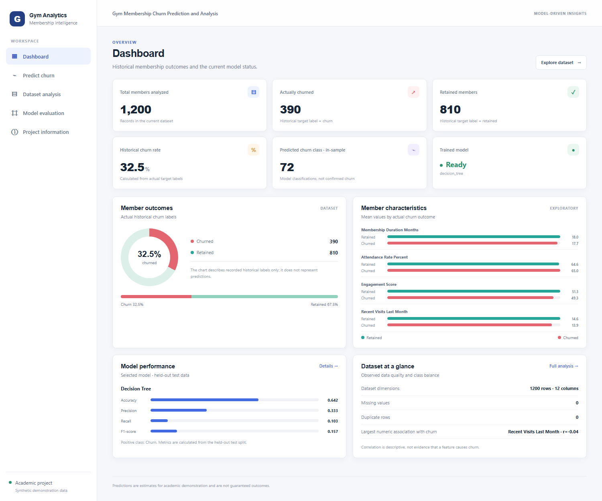

# Gym Membership Churn Prediction and Analysis

A responsive Flask application that explores gym membership data, compares churn classifiers, reports held-out evaluation results, and predicts churn using a saved scikit-learn pipeline.

## Website


## Dashboard screenshot



## Important dataset note

This project currently uses the synthetic demonstration dataset at `data/processed/gym_churn_data.csv`. It does not contain real gym member records. Dataset statistics and model metrics are for demonstration and must not be presented as real-world findings.

## Run locally

Requirements: Python 3.10 or later.

```powershell
python -m venv .venv
.\.venv\Scripts\Activate.ps1
python -m pip install -r requirements.txt
python app.py
```


If you already installed the dependencies, run only `python app.py` from the project directory.

Run the automated checks:


## Application pages

| Page | Purpose |
|---|---|
| Dashboard | Actual historical churn and retention counts, model status, predicted class count, and selected-model test metrics |
| Predict Churn | Validates model input fields and displays the predicted class and probability when supported |
| Dataset Analysis | Displays the dataset schema, data quality, distributions, descriptive statistics, and feature relationships |
| Model Evaluation | Shows test-set metrics, model comparisons, confusion matrix, ROC curve, classification report, and supported feature importance |
| Project Information | Summarizes the project scope, methods, and limitations |

The CSV analysis is downloadable from **Dataset Analysis → Download analysis CSV**.

## Machine-learning workflow

1. Load the existing project CSV. Demonstration data is generated only if the CSV is absent.
2. Split data into a stratified 80% training set and 20% test set, using `random_state=42`.
3. Compare Logistic Regression, Decision Tree, and Random Forest with five-fold stratified cross-validation on the training set. Select by mean Churn-class F1; mean ROC-AUC breaks ties.
4. Use a scikit-learn pipeline to fit preprocessing on training folds only: median imputation and standard scaling for numeric features; most-frequent imputation and one-hot encoding for categorical features.
5. Evaluate candidate models on the held-out test set. Test-set results do not determine model selection.
6. Refit the selected pipeline on all available rows for deployment inference and save it in `artifacts/models/`.

Model training is deliberate; the app loads the saved model for predictions instead of retraining on every page visit. If the model artifact is missing, use **Train models** on the prediction page or run:

```powershell
python -c "from src.ml_pipeline import train_and_evaluate_models; train_and_evaluate_models()"
```

## Current evaluation snapshot

The checked-in model summary reports the following selected Decision Tree results on the held-out test split:

| Metric | Value |
|---|---:|
| Accuracy | 0.642 |
| Churn precision | 0.333 |
| Churn recall | 0.103 |
| Churn F1-score | 0.157 |
| ROC-AUC | 0.502 |

The positive class is **Churn** (`1`); **No Churn** is `0`. Precision measures how many predicted churn cases actually churned. Recall measures how many actual churn cases were identified. F1 is their harmonic mean:

`F1 = 2 × (Precision × Recall) / (Precision + Recall)`

In particular, the recorded churn recall is low: the selected model misses many churn cases on this test split. These figures describe the current synthetic data and evaluation split only; they do not demonstrate performance on real or future gym members. No Low/Medium/High risk category is applied because a decision threshold has not been separately validated.

## API endpoints

| Method | Endpoint | Description |
|---|---|---|
| `GET` | `/api/dashboard` | Dashboard statistics |
| `GET` | `/api/dataset` | Dataset analysis |
| `GET` | `/api/evaluation` | Saved evaluation results |
| `POST` | `/api/predict` | Prediction from a JSON object matching the model's input fields |
| `POST` | `/api/train` | Explicitly retrain and save model artifacts |
| `GET` | `/dataset/report.csv` | Download column-level analysis as CSV |

## Project structure

```text
app.py                         Flask routes and web application
src/ml_pipeline.py             Dataset, preprocessing, training, evaluation, inference
templates/                     Jinja HTML pages
static/css/style.css           Responsive styling
data/processed/                Existing CSV dataset and generated analysis image
artifacts/models/              Saved model, preprocessing, and evaluation summary
docs/images/dashboard.png      Dashboard screenshot used above
tests/test_app.py              Application and prediction tests
requirements.txt               Python dependencies
```

## Technology

Python, Flask, pandas, NumPy, scikit-learn, joblib, HTML, CSS, and JavaScript. Charts are rendered using CSS and SVG; no separate frontend build system is required.

## Limitations

- The dataset is synthetic demonstration data, not actual gym-member data.
- Churn outputs are model estimates, not guaranteed outcomes or proof of causality.
- Test metrics should not be generalized beyond the current dataset and split.
- The app is public only after deployment; a localhost address is not a public website URL.
